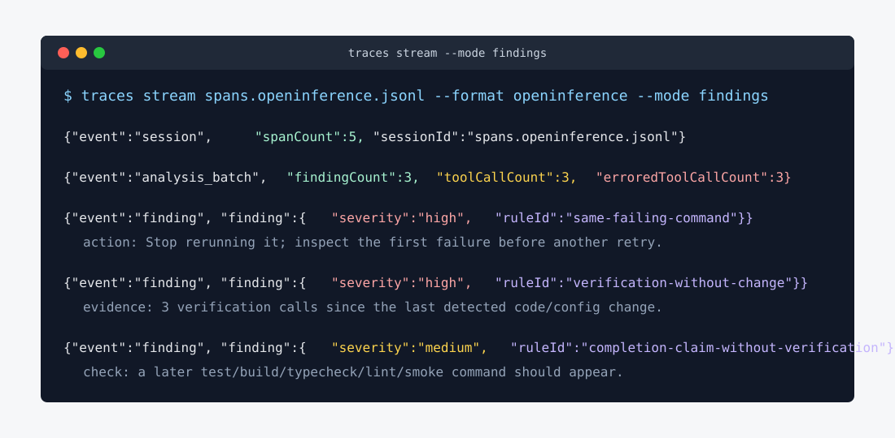

# Watch and stream live sessions

[traces](../README.md#docs) › Watch and stream live sessions

## Live stream

`traces watch` is the human terminal view.
It prints repeated-tool loops and semantic findings while a coding agent is still running.

`traces stream` is the machine feed.
It emits newline-delimited JSON events that a dashboard, art visualizer, local watcher, or hosted product can consume without scraping terminal prose.

```bash
traces stream
traces stream --mode findings
traces stream --mode agent
traces stream spans.openinference.jsonl --no-spans
```

Live streaming emits `session`, `span`, `analysis_batch`, `finding`, and `tick` events; `--mode agent` also emits `report` events.
The findings are the rules `traces analyze` ranks (`src/pipelines.ts`): a command that failed 3 or more times in a row, a check rerun 3 or more times with no edit between, a completion claim after an edit with no check since, and high tool-error rates.
Use `--mode findings` when you want the low-volume meaning layer; keep `visualizer` for real-time views that need motion, timing, and tool-call texture.
Use `--mode agent` when another agent needs deterministic loop/tool-use reports alongside the findings.
The same JSONL shape is used for live sessions and replayed trace files:



Custom live analysts go through the SDK: `streamSessions({ extraAnalysts })` runs them after the built-in rules, on the same classified actions.

## Watch a run tree

`traces watch <target>` tails ONE run that fans work out to other agents, instead of one harness session.
It prints the tree at any depth: per node the status, the runtime, the authored budget, and the actual spend.
Plain stdout, no cursor control, no extra dependency — it works over SSH, in a CI log, and through a pipe.

```bash
traces watch runs/my-run                 # live: reprints only when something changed
traces watch runs/my-run --once          # one snapshot, for a script or an agent
traces watch traces.otlp.jsonl           # spans only, for any emitter
```

Two sources sit behind the one verb, and the output always names which number came from which:

| Source | Reads | Gives you | Cannot give you |
|---|---|---|---|
| **General** — OTLP spans | `trace_id` / `span_id` / `parent_span_id` in any `*.otlp.jsonl`, `*.spans.jsonl`, `*.traces.jsonl` | tree shape, wall time, per-turn tokens, cost when the emitter priced it | the authored budget — no span vocabulary carries one |
| **Specific** — the spawn journal | `spawn-journal.jsonl` written by agent-runtime's `createFileRunContext` | authored budget, settled spend, settlement status, blocking questions, steers, the typed result | per-turn detail the journal does not tap |

The general source is the one that matters for a system nobody has written yet: anything that emits a parent span pointer gets a tree, whether it is a supervisor, a pi session, a Claude subagent fan-out, or a custom fanout.
Attributes are read through `@tangle-network/agent-eval/trace-attributes` alias lists, so both live vocabularies — OpenInference's `llm.token_count.*` and GenAI semconv's `gen_ai.usage.*` — already work, and no key is invented here.

Two rules the view will not bend on:

- **Driver inference and child work never merge.** A node that drove and the work it delegated are separate lines, because one total cannot answer "which half spent the budget" — the decisive question in three real runs.
- **Unknown is never rendered as zero.** A turn the harness did not price reads `cost unknown (n unpriced)`, never `$0.0000`. A recorded `$0` paid on real tokens is printed AND flagged, because "free" and "unmetered" are different facts.

```
run proof-harness-mcp-20260731i
  2 node(s) · depth 1 · elapsed 9m59s
  driver total    in 639,632 · out 35,077 · $0.0000 (zero across 58 priced)
  worker total    in 47,965 · out 515 · cost unknown (1 unpriced)

● · root  [pending]  supervisor  inline  budget 12it/400,000tok/$2.00/15m00s
    driver    58 turn(s) · in 639,632 · out 35,077 · $0.0000 (zero across 58 priced) · 169% tok of budget
    children  1 settled · in 47,965 · out 515 · cost unknown (1 unpriced)
└─ ✗ artifact-writer-s0  [failed]  worker  pi  budget 6it/80,000tok  wall 20.8s
       settled   3it · in 47,965 · out 515 · cost unknown (1 unpriced) · 50% it, 61% tok of budget

  ! spend recorded $0 with tokens spent: usdKnown was never set false, so this reads as FREE rather
    than unmetered. A harness-billed brain (a CLI on a subscription) looks exactly like this.

RESULT no-winner · budget-exhausted
```

`traces analyze <run-dir>` writes the full report for the same run.
It also reads `failure.json` when Runtime fails before the first spawn.
Pass a parent directory to combine reports from its Runtime runs.
Eval owns discovery, normalization, and analysis; Traces adds recorded coordination requests and delivery receipts.
Old Loops directories are unsupported.

Replay and resume are a separate concern: they belong to the durable spawn journal, and nothing here routes them through telemetry.
